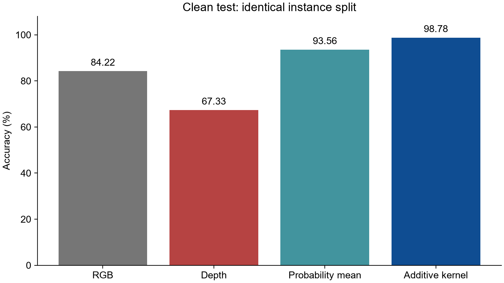
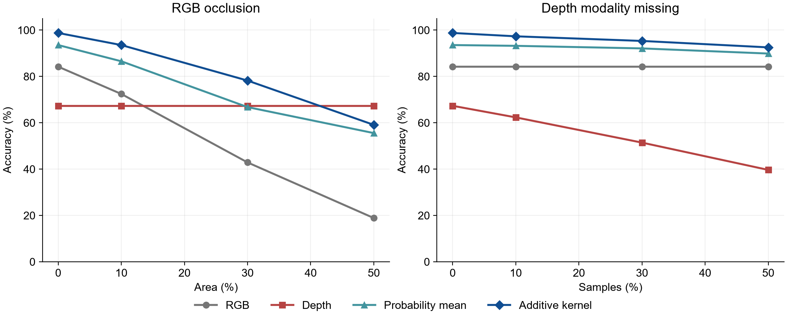

# 基于卷积神经网络与迁移学习的 RGB-D 物体识别

输入一对物体裁剪后的 RGB 图像与深度图，输出物体类别，并比较单模态识别和双模态融合效果。

本项目使用 **ImageNet 预训练、冻结的 ResNet18** 提取特征，训练后续分类器。

| 方法 | 程序中的标识 | 实现 |
|---|---|---|
| 单 RGB | `rgb` | RGB 的 512 维特征 → 线性分类器 |
| 单深度 | `depth` | 深度的 512 维特征 → 线性分类器 |
| 简单平均融合 | `average` | 两个分类器的类别概率等权平均 |
| 基于 SVM 的双模态融合 | `additive_kernel` | 两个模态的 RBF 核等权平均 → SVM |

`additive_kernel` 是现有代码、CSV 和旧结果图中使用的标识，图中的 “Additive kernel” 对应“基于 SVM 的双模态融合”。融合权重固定为 0.5，不自动学习。

## 1. 先看结果


| 方法 | 正常准确率 | 正常 Macro-F1 | RGB 遮挡 50% 时准确率 | 深度缺失 50% 时准确率 |
|---|---:|---:|---:|---:|
| 单 RGB | 84.22% | 82.37% | 18.89% | 84.22% |
| 单深度 | 67.33% | 65.94% | 67.33% | 39.67% |
| 简单平均融合 | 93.56% | 93.16% | 55.56% | 89.89% |
| 基于 SVM 的双模态融合 | 98.78% | 98.78% | 59.11% | 92.56% |





[查看混淆矩阵原图](results/confusion_matrices.png)。

正式实验使用 Washington RGB-D Object Dataset 的 **10 类、48 个物体实例、4,320 对图像**。训练/验证/测试为 2,520/900/900 对，按实例隔离，随机种子为 42。

## 2. 环境与依赖

已验证环境：Windows 11、Python **3.13.9**、PyTorch **2.10.0+cu128**、torchvision **0.25.0+cu128**；原实验 GPU 为 RTX 5060 Laptop（约 8 GB 显存）。普通依赖的精确版本见 [requirements.txt](requirements.txt)。推荐使用 Python 3.13。

PyTorch 单独安装，避免混用 CPU/CUDA 软件源。安装脚本默认选择 **CPU**，无需 NVIDIA 显卡；有兼容 NVIDIA 显卡和驱动时选择 `cu128`。CUDA 版 PyTorch 包含所需运行库，常规运行不需要另外编译 CUDA 工程。下文命令均在项目根目录执行。

### Windows / PowerShell

先安装 Python 3.13，确认 `python --version`，然后二选一：

```powershell
# 推荐：CPU 环境，可完成小样本演示，也可运行完整流程（速度更慢）
powershell -NoProfile -ExecutionPolicy Bypass -File .\setup.ps1 -Torch cpu

# NVIDIA GPU：使用 CUDA 12.8 版 PyTorch
powershell -NoProfile -ExecutionPolicy Bypass -File .\setup.ps1 -Torch cu128
```

脚本会在项目内创建 `.venv`、安装固定版本依赖并运行环境检查。已有可用环境不必重复安装。之后直接使用 `.\.venv\Scripts\python.exe`，不需要激活环境。

### Linux / macOS 手动安装

以下为跨平台等价安装命令；本次实际运行验证在 Windows 完成。

```bash
python3.13 -m venv .venv
source .venv/bin/activate
python -m pip install --upgrade pip
# Linux CPU；Linux NVIDIA GPU 可将 cpu 改为 cu128
python -m pip install torch==2.10.0 torchvision==0.25.0 --index-url https://download.pytorch.org/whl/cpu
python -m pip install -r requirements.txt
python main.py doctor
```

macOS 的 PyTorch 安装行改为 `python -m pip install torch==2.10.0 torchvision==0.25.0`，运行时使用 `--device cpu`；程序目前没有 MPS 入口。激活环境后，可把后文 Windows 命令中的 `.\.venv\Scripts\python.exe` 换为 `python`，路径中的反斜杠换为斜杠。

## 3. 小样本 demo：无需下载完整数据集

仓库的 `demo/samples/` 提供 **18 对真实原始图像**：apple、ball、banana 三类，每类 3 个实例，每实例 2 帧。RGB 和深度原文件未修改；来源、原始相对路径和 SHA-256 见 [demo/samples.json](demo/samples.json)。demo 会自行按实例划分，训练/验证/测试各 6 对。

安装环境后运行：

```powershell
.\.venv\Scripts\python.exe main.py all --data demo/samples --work runs/demo --skip-download --device cpu --max-classes 3 --max-frames 2 --epochs 5 --batch-size 4

# 用刚训练的 demo 模型识别第一对测试原图
.\.venv\Scripts\python.exe main.py predict --work runs/demo --device cpu
```

第一条命令完成数据准备、真实 ResNet18 特征提取、四方法所需模型训练、七种条件评估和 6 对原图核查。首次提取会自动下载 ImageNet ResNet18 权重（约 45 MB），需要联网；缓存位于 `cache/torch/hub/checkpoints/`。以后可以使用已有权重离线运行。

预期产物包括：

- `runs/demo/figures/samples.png`：样本预览。
- `runs/demo/results/metrics.csv`：4 种方法 × 7 个条件，共 28 行指标。
- `runs/demo/results/verification.json`：正常结束时 `status` 为 `PASS`。
- 单样本预测输出：样本编号、真实类别（已知时）、四种方法的类别预测。

**demo 用于确认整个程序能运行，样本少、训练轮数少，成绩不能作为正式实验结论，也不保证预测全部正确。** 其模型只有三个类别；识别其他类别需使用正式训练模型。

再次执行相同 `all` 命令会复用已有特征和模型，并刷新评估结果。如需重训或更改参数，将 `--work` 换为新目录，例如 `runs/demo2`。

## 4. 正式数据下载

数据来源：[Washington RGB-D Object Dataset 官方网站](https://rgbd-dataset.cs.washington.edu/)。本项目使用官方 evaluation set 中已裁剪的 RGB/深度图像，不需要下载全部未裁剪视频。

```powershell
.\.venv\Scripts\python.exe main.py download --data data
```

下载器访问以下官方目录：

`https://rgbd-dataset.cs.washington.edu/dataset/rgbd-dataset_eval/`

下载 `README.txt`、`testinstance_ids.txt` 和 `rgbd-dataset_eval.zip`，完成后自动解压。中断的下载先保留为 `.part`；重试会重新下载该未完成文件。已存在的完整文件跳过下载，未完成的解压可以再次执行下载命令恢复。

也可以手动从官方目录下载并解压，保持 `类别/实例/*_crop.png` 与 `*_depthcrop.png` 的文件名。准备数据时用 `--data` 指向包含这些文件的目录，程序会递归扫描。完整数据集占用明显大于 demo，请预留解压空间。

RGB 文件为三通道图像，深度文件为单通道整型毫米值，0 表示无效测量。彩色深度预览图不能替代原始深度图。保留数据目录中官方自带的 README、实例划分和定位信息，它们属于数据集元数据。

## 5. 正式实验复现命令

### 一键执行

下载完成后，选择一个新的实验目录：

```powershell
.\.venv\Scripts\python.exe main.py all --data data --work runs/reproduce42 --skip-download --device auto --seed 42 --max-classes 10 --max-frames 90 --epochs 40 --batch-size 16
.\.venv\Scripts\python.exe main.py predict --work runs/reproduce42 --device auto
```

`auto` 在 CUDA 可用时使用 GPU，否则使用 CPU。去掉 `--skip-download` 可将下载合并进一键流程。`all` 最后自动执行指标核查和 6 对原图回放。不同硬件、计算后端的浮点差异可能导致结果细微变化。

### 分步执行

与上面的一键路线二选一；各步必须使用同一个新实验目录：

```powershell
.\.venv\Scripts\python.exe main.py prepare --data data --work runs/manual42 --seed 42 --max-classes 10 --max-frames 90
.\.venv\Scripts\python.exe main.py extract --work runs/manual42 --device auto --batch-size 16
.\.venv\Scripts\python.exe main.py train --work runs/manual42 --epochs 40
.\.venv\Scripts\python.exe main.py evaluate --work runs/manual42 --device auto
.\.venv\Scripts\python.exe main.py verify --work runs/manual42 --raw-count 6 --device auto
.\.venv\Scripts\python.exe main.py predict --work runs/manual42 --device auto
```

`train` 在 CPU 上训练线性分类器和 SVM，没有 `--device` 参数。特征提取及遮挡图像重编码可以使用 GPU。显存不足时减小提取的 `--batch-size`，评估默认沿用提取批大小。

### 输入自己的图像

先完成正式训练，再将下面两条图像路径替换为真实的配对物体裁剪图：

```powershell
.\.venv\Scripts\python.exe main.py predict --work runs/reproduce42 --rgb "path/to/object_rgb.png" --depth "path/to/object_depth.png" --device auto
```

两张图必须同时提供、尺寸一致且已经配准。输出限定于模型训练过的类别。单图入口不会自动识别“缺失深度”；缺失实验由评估模块传入显式标记。

### 实验设置

- 默认选择按字母排序的前 10 个合格类别：apple、ball、banana、bell_pepper、binder、bowl、calculator、camera、cap、cell_phone。
- 每类随机保留一个物体实例测试、一个验证，其余训练；每实例最多均匀采样 90 帧。
- RGB 双线性缩放到 224×224；深度仅从训练集估计 1%/99% 分位范围，有效深度映射至 [0.05,1]，无效值保留为 0，再最近邻缩放并复制成三通道。
- 同一个冻结 ResNet18 分别提取两种模态的 512 维特征，再做 L2 归一化。
- 线性分类头：Adam、学习率 0.003、权重衰减 1e-4、批大小 128、40 轮；按验证损失选择轮次。
- SVM：融合核为两个尺度归一化 RBF 核的平均；仅用训练特征估计尺度。搜索 C={0.1,1,10,100}、gamma={0.5,1,2}，按验证准确率、再按 Macro-F1 选择；不把验证集并入重训。
- 评估：正常输入；RGB 遮挡 10%/30%/50% 面积；深度完全缺失 10%/30%/50% 的测试样本。两种融合在深度缺失时回退到同一个 RGB 线性分类器；单深度用均匀概率并按 argmax 取首类。

## 6. 代码结构与重要接口

```text
RGBD_Fusion_Coursework/
├── README.md                   项目唯一人工维护的使用说明
├── requirements.txt            普通 Python 依赖的精确版本
├── setup.ps1                   CPU / CUDA 环境安装及检查
├── main.py                     命令解析、阶段调度
├── rgbd_data.py                下载、配对、实例划分、预处理
├── rgbd_models.py              冻结编码器、特征缓存、核函数
├── rgbd_experiment.py          训练、四方法预测、评估、绘图
├── verify_results.py           独立指标重算、模型与原图回放
├── tests/test_pipeline.py      实现测试
├── demo/samples/               18 对真实 RGB-D 小样本
├── demo/samples.json           demo 样本来源与文件校验值
├── results/                    可直接浏览的正式实验结果快照
├── .gitignore                  排除本地环境、完整数据、权重和缓存
└── .gitattributes              文本换行与二进制文件设置
```


| 阅读顺序 | 文件与接口 | 作用 |
|---|---|---|
| 1 | [rgbd_data.py](rgbd_data.py)：`scan_pairs`、`split_instances`、`preprocess` | 从成对原图到隔离的样本清单和张量输入 |
| 2 | [rgbd_models.py](rgbd_models.py)：`make_encoder`、`encode` | 冻结 ResNet18，顺序处理 RGB 与深度并缓存特征 |
| 3 | [rgbd_experiment.py](rgbd_experiment.py)：`fit_head`、`train` | 分类头训练、验证选模、12 组 SVM 搜索 |
| 4 | [rgbd_models.py](rgbd_models.py)：`additive_kernel` | 计算 RGB 与深度核的等权平均 |
| 5 | [rgbd_experiment.py](rgbd_experiment.py)：`predict_features`、`predict_image` | 统一预测接口、缺失回退、原图推理 |
| 6 | [rgbd_experiment.py](rgbd_experiment.py)：`evaluate` | 使用相同样本和扰动比较四种方法 |
| 7 | [verify_results.py](verify_results.py)：`verify` | 独立核查结果与模型是否一致 |
| 8 | [main.py](main.py)：`main` | 将各模块组合为命令行流程 |

每次实验目录中的 `manifest.json` 保存样本路径与划分，`features.npz` 保存对齐的特征，`model.pt` 保存线性分类头，`fusion.joblib` 保存 SVM 与训练参考特征，`training.json` 保存训练与选参记录。其 `results/` 保存逐样本预测、指标、三张图和核查报告。

根目录的 `results/` 只是正式结果快照，不能作为 `--work` 加载模型；重新运行的结果保存在 `runs/<实验名>/results/`，不会覆盖展示快照。

## 7. 检查与常见问题

```powershell
.\.venv\Scripts\python.exe main.py doctor
.\.venv\Scripts\python.exe -B -m pytest tests -q -p no:cacheprovider
```

测试不下载完整数据集或预训练权重，使用人工构造的小数据检查实例隔离、训练集统计、核计算、缺失回退、验证选模及篡改指标检测等。测试数据的成绩不作为真实实验结果。

- **文件已存在 / 配置变化**：手动 `prepare/extract/train` 防止覆盖旧产物；更换新的 `--work`。相同配置的 `all` 可复用已完成阶段，不会重新训练。
- **CUDA 不可用**：选 CPU 安装并使用 `--device cpu`，或检查 NVIDIA 驱动与 PyTorch 安装是否匹配。
- **首次权重下载失败**：重试网络连接，或在可联网机器取得同版本 `resnet18-f37072fd.pth` 并放入 `cache/torch/hub/checkpoints/`。
- **只评估正常输入**：`evaluate --levels 0` 会覆盖该实验目录的评估文件；完整比较使用默认参数。
- **迁移已有实验目录后路径失效**：manifest 保存了原数据根目录的绝对路径。建议在新机器用新 `--work` 重新准备和训练；本仓库不分发含本机路径的完整运行目录。
- **扩大数据规模**：SVM 的训练核矩阵占用按训练样本数量的平方增长，全量运行前应评估内存。


## 8. 数据与文献来源

demo 图像来自 Washington RGB-D Object Dataset，原始数据的权利和使用要求归原作者；

> Kevin Lai, Liefeng Bo, Xiaofeng Ren, Dieter Fox. A Large-Scale Hierarchical Multi-View RGB-D Object Dataset. ICRA, 2011.

- [数据集官方网站](https://rgbd-dataset.cs.washington.edu/)
- [数据集论文列表](https://rgbd-dataset.cs.washington.edu/publications.html)
- [ResNet：Deep Residual Learning for Image Recognition](https://arxiv.org/abs/1512.03385)


